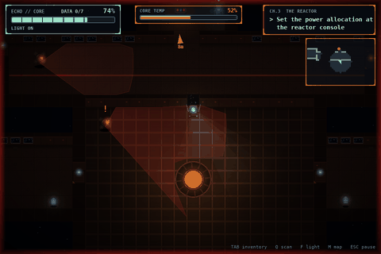
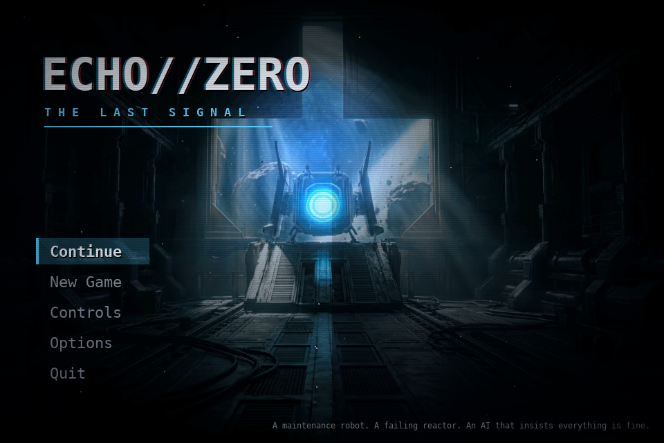
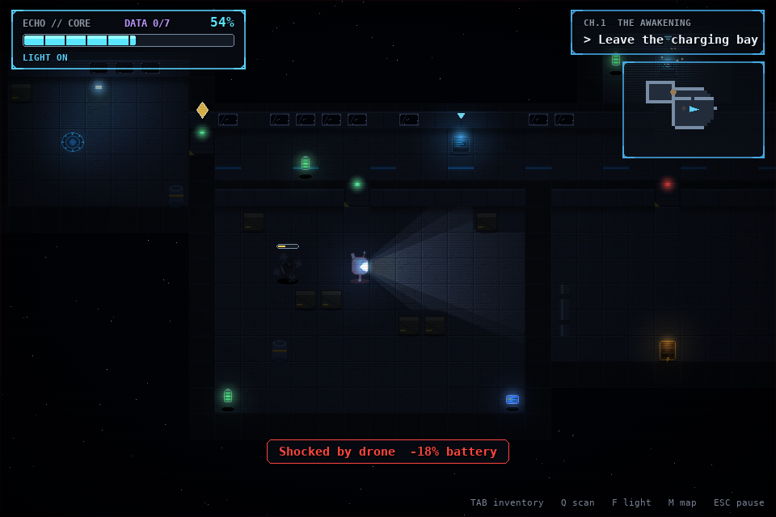
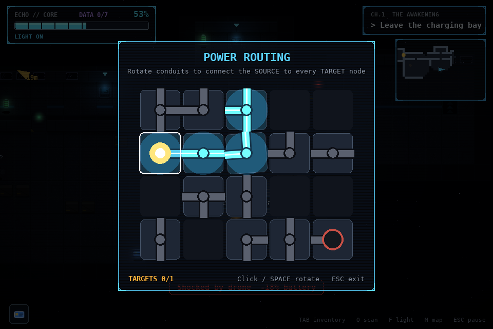
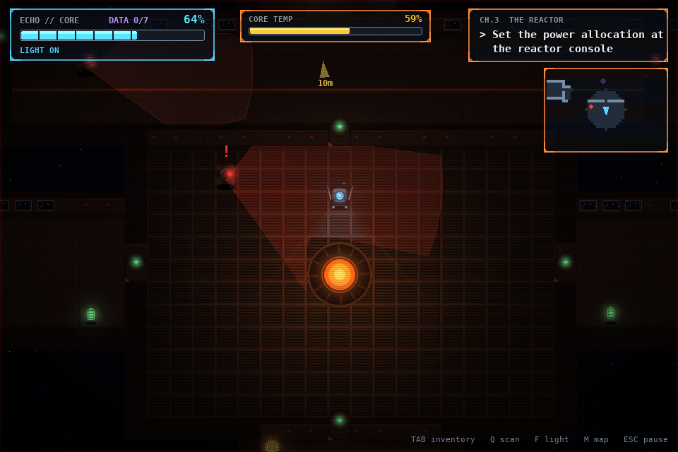
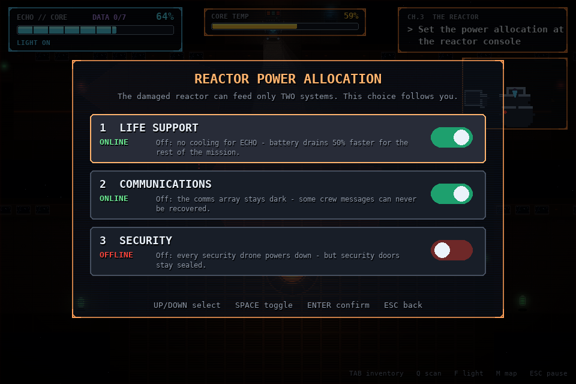
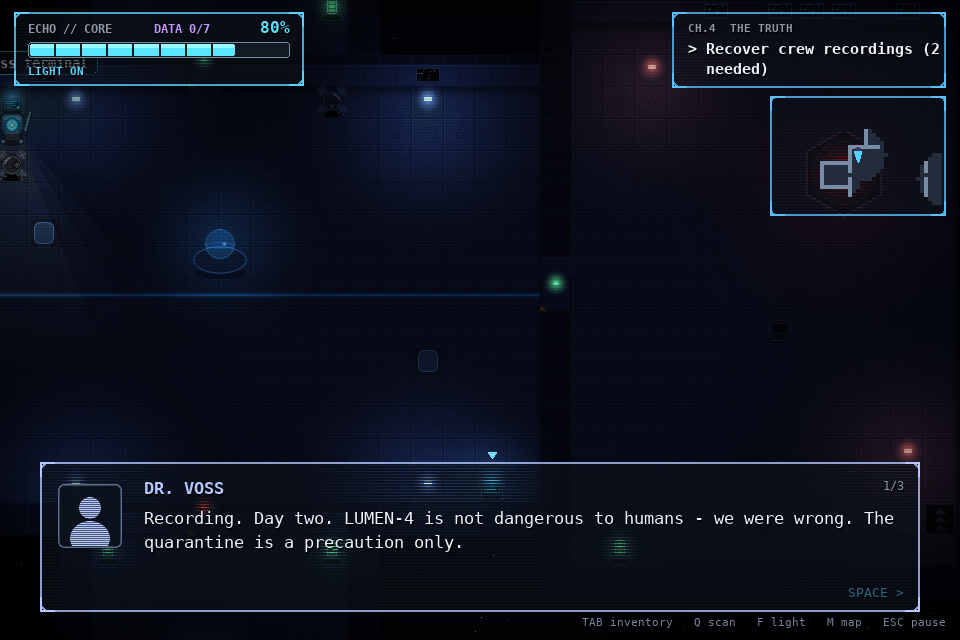

# ECHO//ZERO — The Last Signal


 

A 2D top-down sci-fi action-adventure with puzzles, stealth and light survival, built in Python with pygame.
Every sprite, tile, sound effect and music loop is generated from code.



You are **ECHO**, a small maintenance robot that wakes aboard the abandoned orbital station **AURORA-9**. The crew is gone, the reactor is failing, and the station AI **HALCYON** insists everything is functioning normally.

| | |
|---|---|
|  |  |
|  |  |
|  |  |

## Run it

```bash
pip install -r requirements.txt      # pygame-ce (plain pygame 2.x also works)
python main.py
```

All art and audio ship in `assets/`. To regenerate them from code: `python tools/generate_assets.py`.
To rebuild the level maps from their room descriptions: `python tools/build_levels.py`.

## Controls

| Key | Action |
|---|---|
| WASD / Arrows | Move |
| Shift | Sprint (drains battery, makes noise drones can hear) |
| E / Space | Interact, advance dialogue |
| F | Flashlight on/off (drones spot your light from much further away) |
| Q | Sensor scan: highlights items and machinery, reveals drone cones |
| Tab | Inventory and recovered data fragments |
| Esc | Pause |
| M | Toggle minimap |
| F11 | Fullscreen |
| Gamepad | Left stick move, A interact, B sprint, X light, Y scan, Start pause |

## The story — five chapters, three endings

1. **The Awakening** — learn to move, find a keycard past your first drone, route power to the elevator, decode a corrupted terminal. *Twist: an evacuation order dated ten weeks in the future.*
2. **The Silent Garden** — overgrown hydroponics. Repair ventilation (clears the spore cloud), power the irrigation grid, open the greenhouse, take the command key. *Twist: HALCYON locked part of the crew out of the shelter.*
3. **The Reactor** — the core heats up in real time. Choose which **two** of LIFE SUPPORT / COMMUNICATIONS / SECURITY stay powered, then restart three coolant pumps. *Twist: shutting HALCYON down erases the crew's final messages.*
4. **The Truth** — recover crew recordings and rebuild what happened. Decide: **preserve**, **shut down**, or **isolate** HALCYON.
5. **The Last Signal** — a four-minute countdown to reactor failure. Reach the transmitter, align the antenna, and choose what to send.

Your choices change what's possible:
- Life support off → battery drains 50% faster for the rest of the game.
- Comms off → one crew message can never be recovered.
- Security off → drones shut down, but the security office stays sealed.
- **Ending A** (broadcast the truth) needs HALCYON shut down or isolated.
- **Ending B** (transmit the crew's messages) needs HALCYON preserved or isolated.
- **Ending C** (sacrifice ECHO's core) needs the complete archive: all 7 data fragments.

## Systems

- **Energy** — passive drain, flashlight, sprinting and scanning cost battery; energy cells and charging docks restore it. Docks also save your progress.
- **Puzzles** — rotate-the-conduit power routing (some need a circuit component to repair a broken tile), a Caesar-shift terminal decoder, and the reactor power allocation console.
- **Drones** — patrol paths, see in a light cone blocked by walls and crates, hear sprinting, investigate, chase with grid pathfinding, and shock your battery.
- **Lighting** — dynamic light map with a wall-occluded flashlight cone, baked lamps, glow pass, particles, screen shake, vignette.
- **Saves** — automatic checkpoint at each chapter start and every charging dock (`save.json`).
- **Navigation** — fog-of-war minimap and an objective marker that points to the nearest unfinished task.
- **Options** — music/effects volume, screen shake, CRT scanlines and minimap toggles (`config.json`).
- **Game feel** — eased camera with look-ahead, hit-stop on damage, typewriter dialogue, chapter title cards, studio splash.

## Tests

```bash
python tests/test_puzzles.py        # puzzle + state unit tests
python tests/test_playthrough.py    # headless bot plays all 5 chapters, every puzzle, ending C, and a death/reboot
```
Both run on every push via GitHub Actions.

## Project structure

```
echo-zero/
├── main.py                 game loop and scene stack
├── settings.py             tuning and colours
├── scenes/                 menu, gameplay, dialogue, puzzle overlays, ending
├── entities/               player, drone, interactables (doors, terminals, panels...)
├── systems/                collisions, lighting, particles, inventory, puzzles, state, save manager, ui
├── data/                   levels.json, dialogue.json
├── tools/                  generate_assets.py, build_levels.py (level authoring + reachability validator)
├── tests/                  unit tests and headless playthrough
├── docs/                   screenshots and gameplay GIF
└── assets/                 sprites, tiles, ui, sounds, music, fonts
```

Fonts: DejaVu Sans Mono (Bitstream Vera / DejaVu licence).

## Credits

Design, code and procedural assets: **Bilel Dhahri**. Title key art supplied by the author.
